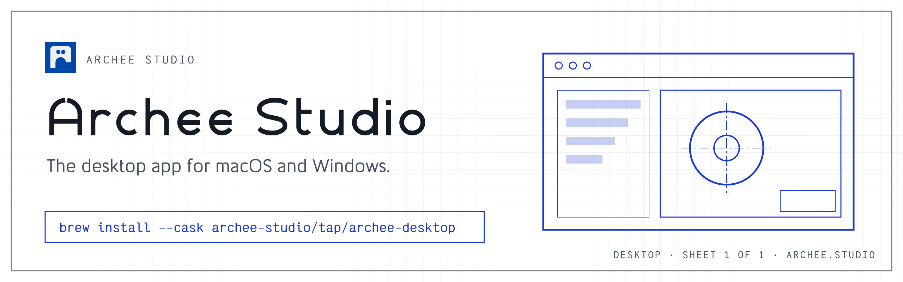

<picture>
  <source media="(prefers-color-scheme: dark)" srcset="assets/banner-dark.png">
  
</picture>

**Archee Studio in a native window**, for macOS and Windows.

```sh
brew install --cask archee-studio/tap/archee-desktop
```

Or download from [archee.studio/download](https://archee.studio/download/). Each [release](https://github.com/Archee-Studio/archee-desktop/releases) lists a SHA-256 for every installer.

## For agents

```text
Read AGENTS.md in this repository. Then build the installer for my system with `bun install && bun run build` and tell me where it is.
```

## Licence

[Apache-2.0](LICENSE). Published from the Archee Studio source with each release. Security: [SECURITY.md](SECURITY.md).
